# Where does delta-hedging P&L come from?

A simulation study of how a dealer who sells an option and delta-hedges it
actually makes or loses money, and how that changes when the textbook
assumptions (continuous trading, known volatility, no costs, GBM) break.

## Run the dashboard

Needs Python 3.10 or newer and an internet connection; no account or API
keys. From this folder:

```bash
python3 -m pip install -r requirements.txt
python3 -m streamlit run desk/app.py --server.headless true
```

Then open http://localhost:8501 in a browser. The first load takes a few
seconds while it downloads ten years of prices; after that they are kept
in `data_cache/`. If the public data sources are unreachable, pick
"Demo (synthetic)" in the sidebar to see every screen on made-up data.

## Layout

```
hedging/
  bs.py       vectorised Black-Scholes price, delta, gamma, vega, theta,
              implied vol
  paths.py    GBM, Heston (stochastic vol) and Merton (jump) simulators
  hedge.py    discrete delta-hedging engine + gamma P&L attribution,
              mark-to-market P&L paths, implied-vs-realised variance edge,
              proportional costs, delta-band hedging, Leland's vol
pricing/
  american.py     binomial tree and Longstaff-Schwartz Monte Carlo
  pde.py          Crank-Nicolson solver: European, American, knock-out barriers
  heston.py       Heston prices by Fourier transform (characteristic function)
  calibration.py  fit Heston's five parameters to a quoted smile
desk/
  app.py          the dashboard (Streamlit): chain & pricer (click a strike, change any
                  of the five pricing inputs, see the Greeks, the value curves and
                  Black-Scholes with the numbers filled in), vol surface, realised vs
                  implied, hedging backtests
  data.py         public data (Cboe, Yahoo), Alpaca, synthetic demo market; disk cache
  analytics.py    chain implied vols and Greeks, vol cone, backtests on real prices
  charts.py       the dashboard's charts
tests/        515 tests: textbook values, put-call parity, Greeks vs finite
              differences, the BS PDE itself, and hedging-theory properties
experiments/
  stage2_rebalancing.py           hedging error vs rebalancing frequency
  stage3_implied_vs_realised.py   sold at one vol, realised another: which delta?
  stage4_transaction_costs.py     cost vs risk, clock vs delta band, Leland's vol
  stage5_wrong_model.py           Heston and jump paths hedged with Black-Scholes
  stage5b_pricing_toolkit.py      the four pricers checked against each other
results/      charts and tables written by the experiments
```

```bash
pip install -r requirements.txt
python3 -m pytest -q                          # run the test suite
python3 experiments/stage2_rebalancing.py     # regenerate stage 2 results (~10 s)
python3 experiments/stage3_implied_vs_realised.py   # regenerate stage 3 results (~1 min)
python3 experiments/stage4_transaction_costs.py     # regenerate stage 4 results (~1 min)
python3 experiments/stage5_wrong_model.py           # regenerate stage 5 results (~40 s)
python3 experiments/stage5b_pricing_toolkit.py      # regenerate stage 5b results (~25 s)
```

## The desk

```bash
python3 -m streamlit run desk/app.py
```

A dashboard over the engines below, running on real market data with no
account: Cboe's delayed option quotes (about 15 minutes behind) and VIX
history since 1990, and Yahoo Finance daily prices since 2016. Type `SPY`
for the S&P 500 ETF (American options) or `SPX` for the index itself
(European options). These are unofficial public endpoints, fine for study
and not for trading. Alpaca (with keys in `.env`) and a made-up demo market
are the other two sources in the sidebar.

First results on real data (17 Nov 2026):

- **Implied vol has exceeded realised vol 83% of the time.** Since 2016, VIX
  has been above the vol SPY realised over the following 21 days on 83% of
  days, by 3.6 points on average.
- **Selling and hedging at VIX made money on 80% of trades.** Selling a
  3-month ATM call every week at that day's VIX and delta-hedging daily at
  1 bp cost: 530 trades, average P&L +0.58% of spot, std 1.07%, worst
  −5.33%. The correlation between P&L and (sale vol − realised vol) is
  0.80, which is stage 3 on market prices. VIX is a 30-day vol built from
  the whole smile, so this flatters a 3-month ATM option somewhat, and
  overlapping trades are not independent.
- **Heston fits the real smile to 0.3 vol points**, across four expiries
  from one to seven months, with ρ = −0.76. The fitted vol of vol (1.8)
  and mean reversion (9.8) are far beyond textbook values: the model needs
  extreme parameters to produce the steep short-dated skew, a known
  weakness.

## The core idea

A dealer sells an option at volatility σ and holds Δ shares against it. Over one
rebalancing interval, a Taylor expansion of the option value plus the
Black-Scholes PDE (θ + (r−q)SΔ + ½σ²S²Γ − rV = 0) cancels everything except

$$
\text{step P\&L} \;\approx\; -\tfrac12\,\Gamma S^2\left(R^2 - \sigma^2\,dt\right), \qquad R = \frac{dS}{S}
$$

The hedged book is a bet on **realised vs implied variance**. It loses when the
stock moves more than the option was priced for, and earns theta when it moves
less. The stock's drift μ never appears: hedging removes it. The test suite
checks this directly by simulating with drifts from −30% to +30%.

## Stage 2: discrete rebalancing

**Setup.** Short 3-month ATM call, S₀ = K = 100, r = 3%, σ = 20% priced,
hedged *and* realised, real-world drift 8%, 20,000 paths. The same paths are
hedged at every frequency, so the only thing that changes is how often the
hedger trades.

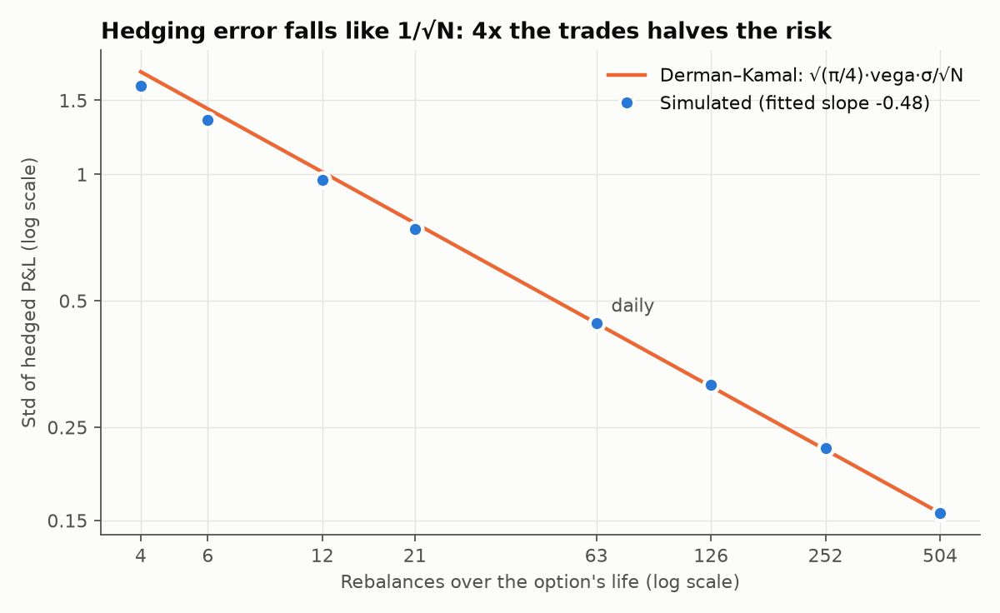

| Rebalances | Frequency | Std of P&L | % of premium | Derman–Kamal prediction |
|---:|---|---:|---:|---:|
| 12 | ~weekly | 0.97 | 22% | 1.01 |
| 63 | daily | 0.44 | 10% | 0.44 |
| 504 | ~hourly | 0.16 | 4% | 0.16 |

Full table: [`results/stage2_summary.md`](results/stage2_summary.md).

**Findings**

1. **The mean is ~0 at every frequency; only the spread changes.** With the
   right volatility, discrete hedging is a fair game. It isn't a cost.
2. **The error falls like 1/√N.** The fitted log-log slope is −0.48 against a
   theoretical −0.5. To halve the risk you have to trade 4x as often, which is
   why transaction costs matter so much (stage 4).
3. **The closed form works.** Derman & Kamal's approximation
   σ_P ≈ √(π/4)·vega·σ/√N matches the simulation to within 1% at daily and
   finer rebalancing. It overstates the error slightly at very coarse
   frequencies, where gamma changes a lot between rebalances.
4. **The P&L has fat tails.** At weekly rebalancing the 1st percentile is
   −2.7, about 2.8 standard deviations from the mean, where a normal
   distribution would put it at 2.3. Big moves hurt a short-gamma book more
   than small moves help it.

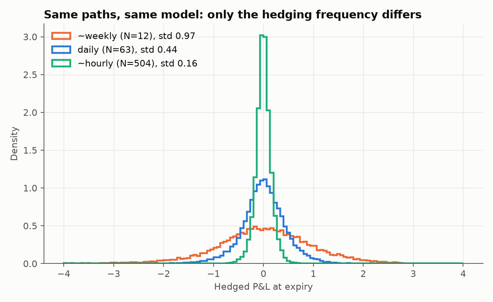

5. **Gamma explains the P&L.** The one-line attribution above has a
   correlation of 0.98 with the true path-by-path P&L at daily rebalancing,
   and 0.99 hourly. What's left over is higher-order terms (Γ changing within
   an interval) and compounding of the cash account.

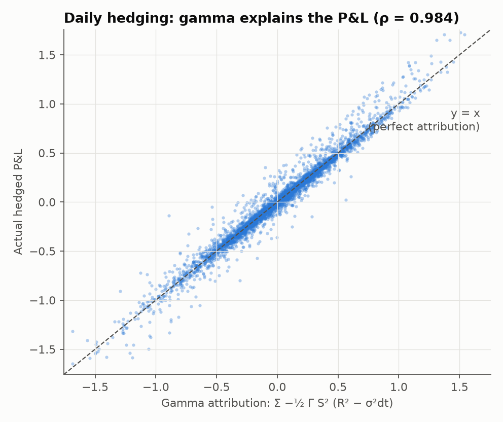

## Stage 3: implied vol ≠ realised vol

**Setup.** Same 3-month ATM call, but now sold at σᵢ = 30% implied vol while
the stock realises σᵣ = 20%. The option was sold for 6.34 against a fair
value of 4.36, so the dealer should make about 2. The question is which vol
to put in the hedge delta. Both hedges run on the same 20,000 paths.

**The maths.** Mark the option at implied vol. Itô's lemma uses the stock's
true variance, dS² = σᵣ²S²dt, while the Black-Scholes PDE that removes theta
is the one at σᵢ. The two no longer cancel:

$$
\text{hedge with } \Delta(\sigma_i):\quad
d\,\text{P\&L} = \tfrac12\,\Gamma_i S^2\left(\sigma_i^2 - \sigma_r^2\right)dt
$$

There is no dW term, so the P&L accrues smoothly and always with the same
sign. Its total is path-dependent, because Γ is large only near the strike.

Hedging with Δ(σᵣ) instead replicates the option's *fair* value exactly, so
the overcharge is locked in, at the cost of carrying a residual stock
position Δᵣ − Δᵢ against the market's mark:

$$
\text{hedge with } \Delta(\sigma_r):\quad
\text{P\&L}_T = \left(V(\sigma_i) - V(\sigma_r)\right)e^{rT},
\qquad
d\,\text{P\&L} = \tfrac12\,\Gamma_i S^2(\sigma_i^2-\sigma_r^2)\,dt
 + (\Delta_r - \Delta_i)\left((\mu - r)S\,dt + \sigma_r S\,dW\right)
$$

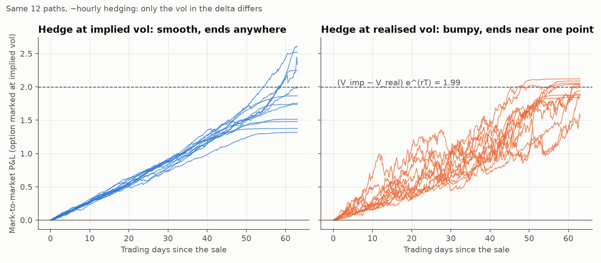

| Rebalancing | Hedge delta | Mean P&L | Std P&L | 1st to 99th percentile |
|---|---|---:|---:|---:|
| ~hourly | implied vol | 2.00 | 0.62 | 0.74 to 3.27 |
| ~hourly | realised vol | 1.99 | 0.16 | 1.57 to 2.39 |
| daily | implied vol | 2.00 | 0.75 | 0.56 to 3.77 |
| daily | realised vol | 2.00 | 0.44 | 0.80 to 3.10 |

Theory: (V(σᵢ) − V(σᵣ))e^{rT} = 1.99. Full tables:
[`results/stage3_summary.md`](results/stage3_summary.md).

**Findings**

1. **Both hedges earn the same on average, 2.00 against a predicted 1.99.**
   The choice of delta changes the risk, not the expected profit (exactly so
   when μ = r; see finding 5).
2. **Hedging at realised vol locks the profit in.** With hourly hedging the
   std is 0.16, a quarter of the implied-vol hedge's 0.62, and what remains
   is purely the discrete-hedging error from stage 2 (0.16 there too). The
   price is a bumpy mark-to-market: the daily P&L swings with the stock
   because the book holds Δᵣ − Δᵢ shares the market's mark doesn't expect.

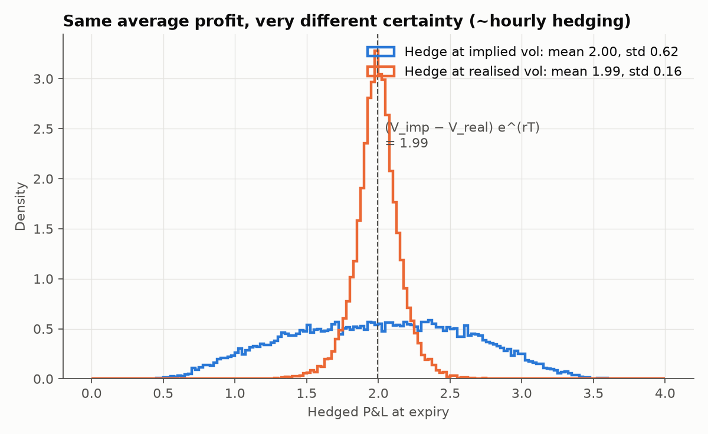

3. **Hedging at implied vol never loses but the amount is a lottery.** Every
   one of the 20,000 paths is profitable, yet the 1st-to-99th percentile
   range is 0.74 to 3.27. The formula ½∫ΓᵢS²(σᵢ² − σᵣ²)dt has a correlation
   of 0.98 with the actual P&L path by path.
4. **The lottery is about where the stock ends up.** Paths that finish
   within 2% of the strike earn 2.8 on average; paths that finish more than
   15% away earn 1.2. Gamma
   is concentrated at the strike near expiry, and that is where the
   variance difference gets paid.

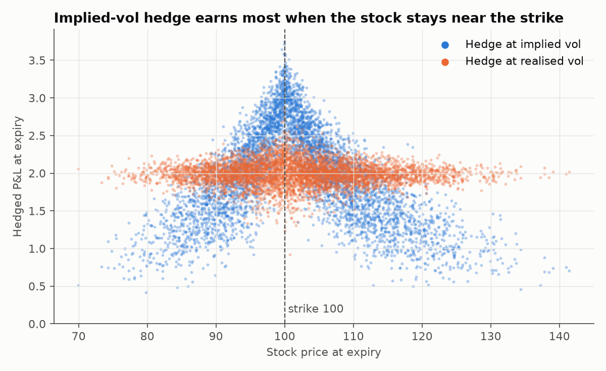

5. **Drift comes back.** With the right vol, μ never mattered. With the
   implied-vol hedge it does: the mean P&L falls from 2.00 at μ = 0 to 1.46
   at μ = −60% and 1.53 at μ = +60%, because a strong trend carries the
   stock away from the strike. The realised-vol hedge stays at 1.99
   throughout.
6. **In practice the lock is only as good as the hedging frequency.** At
   daily rebalancing the realised-vol hedge's std rises to 0.44, so its
   advantage over the implied-vol hedge (0.75) shrinks from 4x to 1.7x.
   And nobody knows σᵣ in advance, which is why desks hedge at implied vol
   and accept the path-dependence.
7. **The P&L is linear in the vol gap.** Across realised vols from 10% to
   50% the mean P&L follows vega × (σᵢ − σᵣ): to within 0.01 for the
   realised-vol hedge and 0.05 for the implied-vol hedge. A short option
   is short vega. When realised vol exceeds implied, the implied-vol
   hedge's losses also become much more dispersed (std 1.96 at 50%).

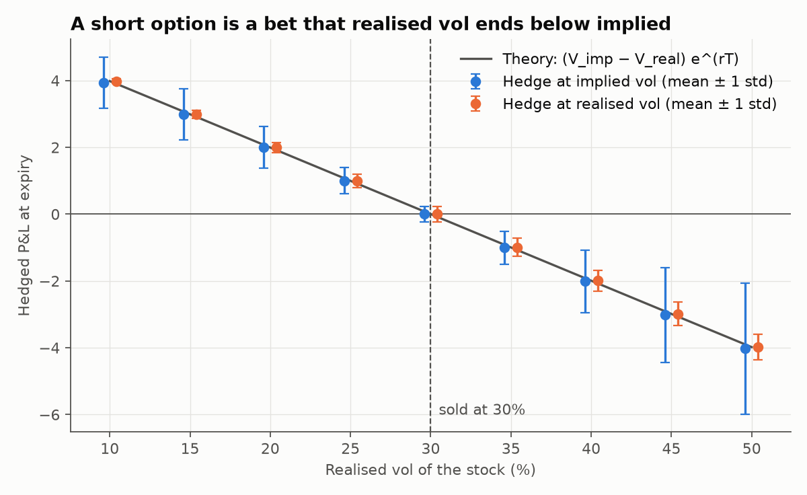

## Stage 4: transaction costs

**Setup.** Back to the stage 2 option (sold, hedged and realised at 20%), but
every trade now costs c = 5 bp of the notional traded. Same 20,000 paths for
every setting.

**The maths.** Each rebalance trades the change in delta, which is roughly
gamma times the stock move, |ΔΔ| ≈ ΓSσ√dt·|Z| with E|Z| = √(2/π). So one
rebalance costs about cΓS²σ√(2dt/π). Each costs √dt, there are T/dt of them,
and the total grows like √N:

$$
\text{rebalancing cost} \approx c\cdot\text{vega}\cdot\sqrt{\frac{2N}{\pi T}},
\qquad
\text{cost}\times\text{risk} \approx \frac{c\,\sigma\,\text{vega}^2}{\sqrt{2T}}
$$

The second expression multiplies the cost by Derman–Kamal's hedging error
from stage 2: N cancels. For a clock-based hedger, halving the risk always
doubles the bill.

Leland (1985) noticed the cost has the same form as the gamma term in the
Black-Scholes PDE, so it can be folded into the vol the option is sold and
hedged at:

$$
\sigma_L^2 = \sigma^2\left(1 + \sqrt{\tfrac{8}{\pi}}\,\frac{c}{\sigma\sqrt{dt}}\right)
$$

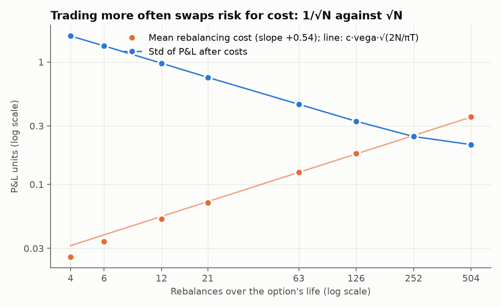

| Rebalances | Frequency | Std of P&L | Mean cost | % of premium |
|---:|---|---:|---:|---:|
| 12 | ~weekly | 0.98 | 0.11 | 2.5% |
| 63 | daily | 0.45 | 0.18 | 4.2% |
| 252 | 4x daily | 0.25 | 0.31 | 7.1% |
| 504 | ~hourly | 0.21 | 0.42 | 9.5% |

Full tables: [`results/stage4_summary.md`](results/stage4_summary.md).

**Findings**

1. **Costs are a pure drag on the mean.** The mean P&L equals minus the
   cost paid: −0.18 at daily hedging and −0.42 hourly, against a premium
   of 4.36.
2. **Cost grows like √N.** The fitted log-log slope is +0.54 against a
   theoretical +0.5, and the closed form matches the simulated rebalancing
   cost to within 1% from daily hedging upwards (0.125 against 0.125 at
   daily). It overstates the cost at very coarse frequencies.
3. **Cost × risk is constant.** The formula gives 0.055; the simulation
   gives 0.051 to 0.057 between weekly and daily hedging.
4. **Past a point, more hedging buys almost nothing.** Going from 4x daily
   to hourly adds 0.10 of cost and removes only 0.03 of risk. The std
   bottoms out at 0.21, above the 0.16 of the cost-free hedge, because the
   costs are themselves random: paths that sit near the strike trade more.

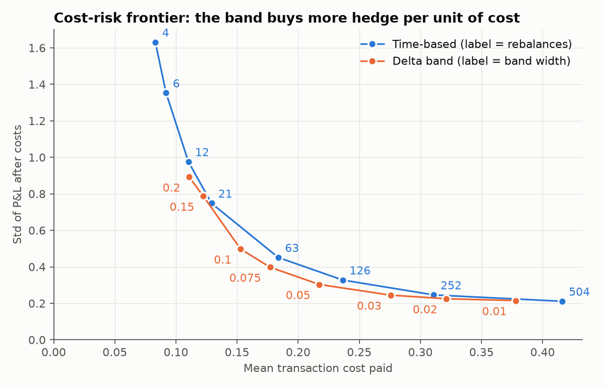

5. **A delta band beats the clock.** Trading only when the position is more
   than a band away from the model delta gives 12–17% less risk for the
   same cost with bands of 0.03 to 0.10. A 0.05 band trades 47 times per
   path, costs 0.22 and leaves a std of 0.30; a clock hedger spending 0.22
   is left with 0.36. The band skips the small trades that cost money but
   remove little risk. At very tight or very wide bands the advantage
   shrinks to under 10%.
6. **Leland's vol pays for the rebalancing.** Selling and hedging at σ_L
   leaves a mean P&L of −0.04 to −0.06 at every frequency from weekly to
   hourly, where selling at 20% loses 0.10 to 0.42. What remains is the
   0.06 cost of putting the hedge on and unwinding it, which the formula
   does not cover.
7. **The price of hedging more often shows up in the quote.** σ_L rises
   from 20.3% for a weekly hedger to 21.7% for an hourly one. At hourly
   hedging the Leland hedge is also less risky (std 0.16 against 0.21).
   It pays almost the same costs (0.40 against 0.42), but hedging above
   realised vol earns ½ΓS²(σ_L² − σ²)dt (stage 3) on exactly the paths
   near the strike where the costs are highest, so the two offset path by
   path (correlation 0.57 between that income and the costs).

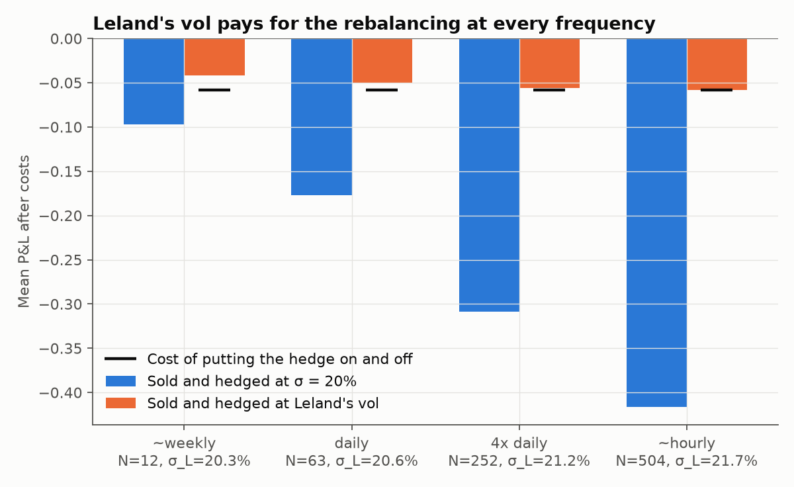

## Stage 5: the wrong model

**Setup.** The same ATM call, sold and hedged with Black-Scholes at 20%, no
costs. The stock now comes from one of three models, all with the same
average variance (20% vol), so the dealer has the level of vol right and
only the model wrong.

| Model | What breaks | Parameters |
|---|---|---|
| GBM | nothing (the control) | σ = 20% |
| Heston | vol is random and falls when the stock rises | κ = 3, θ = v₀ = 0.04, ξ = 0.4, ρ = −0.7 |
| Merton | the stock can gap | 1 jump a year, log size N(−8%, 8%²), diffusive vol 16.5% |

**The maths.** Delta-hedging removes the exposure to small moves of S driven
by one Brownian motion. Heston adds a second one for the variance,

$$
dS = \mu S\,dt + \sqrt{v}\,S\,dW_1, \qquad
dv = \kappa(\theta - v)\,dt + \xi\sqrt{v}\,dW_2, \qquad
\text{corr}(dW_1, dW_2) = \rho
$$

and the stage 3 result still applies step by step: the book earns
½ΓS²(σ² − vₜ)dt, a bet on the variance the path happens to realise. Merton
adds jumps, and a gap J in the stock cannot be traded through. The book
loses the option's convexity over the gap:

$$
\text{loss} = V(S + J) - V(S) - \Delta\cdot J \;\approx\; \tfrac12\,\Gamma J^2
$$

Neither risk depends on how often the hedger trades.

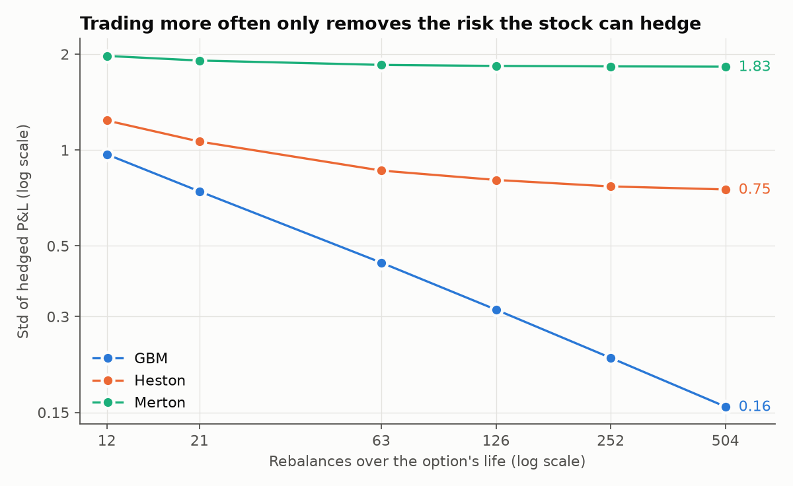

| Model | Rebalancing | Std of P&L | Skew | Worst 1% average | Worst path |
|---|---|---:|---:|---:|---:|
| GBM | daily | 0.44 | −0.3 | −1.5 | −3.6 |
| GBM | ~hourly | 0.16 | −0.1 | −0.5 | −1.1 |
| Heston | daily | 0.86 | −0.9 | −3.3 | −6.7 |
| Heston | ~hourly | 0.75 | −0.6 | −2.7 | −5.1 |
| Merton | daily | 1.85 | −4.0 | −11.1 | −22.6 |
| Merton | ~hourly | 1.83 | −4.2 | −11.2 | −23.0 |

Full tables: [`results/stage5_summary.md`](results/stage5_summary.md).

**Findings**

1. **Hedging more often stops working.** Going from weekly to hourly cuts
   the GBM risk by 84% (0.97 to 0.16), the Heston risk by 39% (1.24 to
   0.75) and the Merton risk by 7% (1.97 to 1.83). What is left is risk
   the stock cannot hedge.
2. **The model decides the tail, not the average vol.** At daily hedging
   the average of the worst 1% of outcomes is −1.5 under GBM, −3.3 under
   Heston and −11.1 under Merton, against a premium of 4.36. The worst
   Merton path loses 22.6, five times the premium.

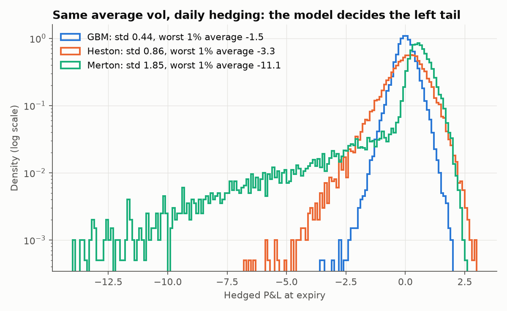

3. **Under Heston the P&L is a bet on realised vol.** The correlation
   between the P&L and the path's realised variance is −0.81, and the
   stage 3 rule of thumb vega × (20% − realised vol) runs through the
   middle of the cloud. Realised vol ranges from 12.5% to 27.8% (5th to
   95th percentile), where under GBM it stays between 17.0% and 22.9%.
4. **Under Merton the dealer picks up pennies in front of a steamroller.**
   The 80% of paths without a jump earn 0.68 on average, because the stock
   only realises 16.5% against the 20% charged. The 20% with a jump lose
   2.26 on average. Every path that loses more than 2 had a jump, and 83%
   of all paths are profitable.

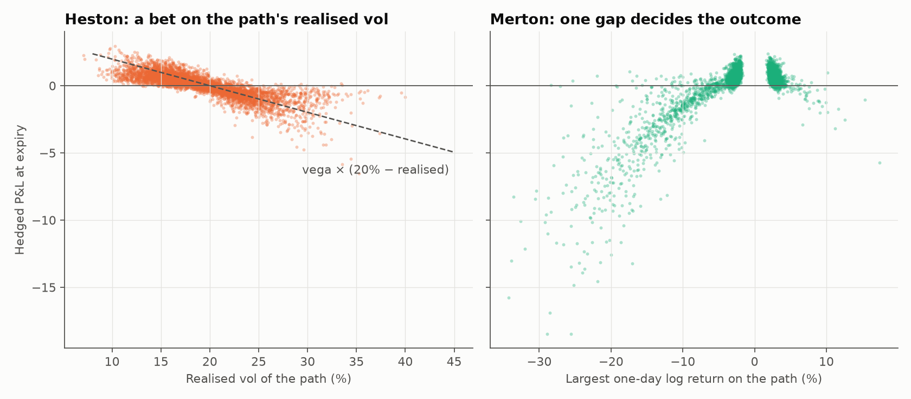

5. **Gamma attribution survives stochastic vol but not jumps.** The
   stage 2 formula −½ΓS²(R² − σ²dt) has a correlation of 0.99 with the
   Heston P&L at daily hedging and 1.00 hourly, but only 0.83 under Merton.
   A 10–20% gap is too large for a second-order expansion.
6. **The smile is what this risk costs.** Pricing each strike by Monte
   Carlo under the model and inverting Black-Scholes gives a downward
   skew: the 90 strike is worth 22.3% vol under Heston and 21.1% under
   Merton, the 110 strike 16.9% and 18.4%. (No risk premium is assumed,
   so real smiles are steeper.)
7. **Selling at a flat 20% is mispricing, and the hedged P&L shows it.**
   A 90 put sold at 20% loses 0.25 on average under Heston and 0.16 under
   Merton, 41% and 25% of its 0.61 premium. A 110 call earns 0.41 and
   0.22. The ATM call is roughly fair in both (+0.04 and +0.09), which is
   why the tails, not the mean, are the story at the money.

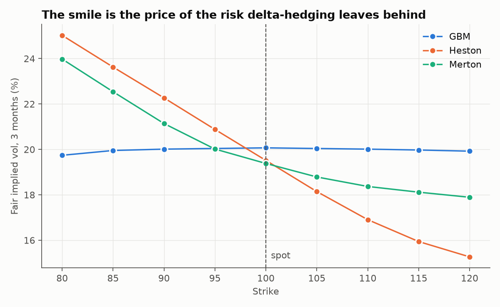

## Stage 5b: pricing toolkit

Stages 2 to 5 used the Black-Scholes formula and, for the Heston smile, a
slow simulation. Real option books need more: listed equity options are
American, desks quote barriers, and a smile model has to be fitted to the
market every day. `pricing/` adds four methods, each documented with its
maths in the module docstring.

| Method | What it prices | Idea |
|---|---|---|
| Binomial tree | American | Step back from expiry; at each node take max(exercise, continue) |
| Longstaff–Schwartz | American, by simulation | Estimate the value of continuing by regression across paths |
| PDE solver | European, American, barriers | Put the Black-Scholes PDE on a grid; Crank–Nicolson time steps |
| Heston Fourier | European under stochastic vol | Invert the characteristic function of ln S_T |
| Calibration | Model parameters from quotes | Least squares on (model − market price) / vega |

**One American put, three methods** (1 year, S = 36, K = 40, r = 6%, vol 20%;
published value 4.486, or 4.478 with 50 exercise dates a year):

| Method | Price | Time |
|---|---:|---:|
| Black-Scholes formula (European) | 3.844 | |
| Binomial tree, 2,000 steps | 4.487 | 0.04 s |
| PDE solver, 400 × 400 grid | 4.486 | 0.05 s |
| Longstaff–Schwartz, 100,000 paths, 50 dates | 4.472 ± 0.009 | 1.4 s |

Full tables: [`results/stage5b_summary.md`](results/stage5b_summary.md).

**Findings**

1. **Early exercise adds 17% to this put.** The American put is worth
   4.49 against 3.84 for the European. Below a stock price of 33.1 the put
   should be exercised immediately. An American call with no dividends is
   never exercised early, and the tree reproduces that exactly.

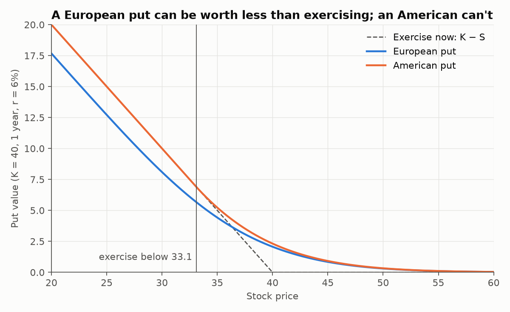

2. **Three methods agree to 0.001 on the tree and PDE, and within Monte
   Carlo error for Longstaff–Schwartz.** Longstaff–Schwartz is lower by
   construction: it allows 50 exercise dates and uses an estimated, so
   slightly suboptimal, exercise rule. It is also 30x slower, and earns its
   place only when there are several underlyings and a grid is impossible.
3. **The tree's error falls like 1/n, the PDE solver's like 1/n².** At
   n = 1,600 the tree is off by 0.0006 and the PDE solver by 0.00001. The
   PDE line is uneven because the strike falls between grid points.

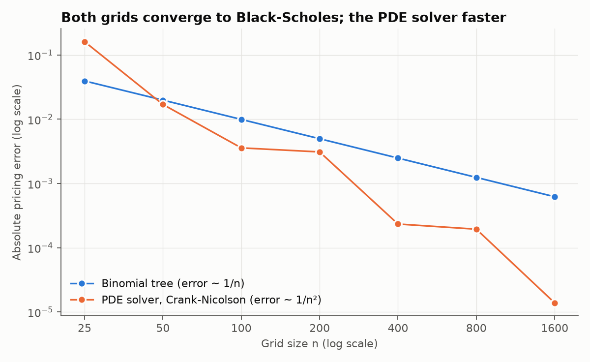

4. **The PDE solver prices barriers to four decimals.** Down-and-out calls
   with barriers from 80 to 99 match the closed form to within 0.0001.
5. **Fourier pricing confirms stage 5's smile.** The largest gap from the
   Monte Carlo smile is 0.15 vol points, inside the simulation's noise.
   Nine prices take 1.5 ms. The implementation reproduces the published
   Broadie–Kaya reference price of 6.8061 to four decimals.

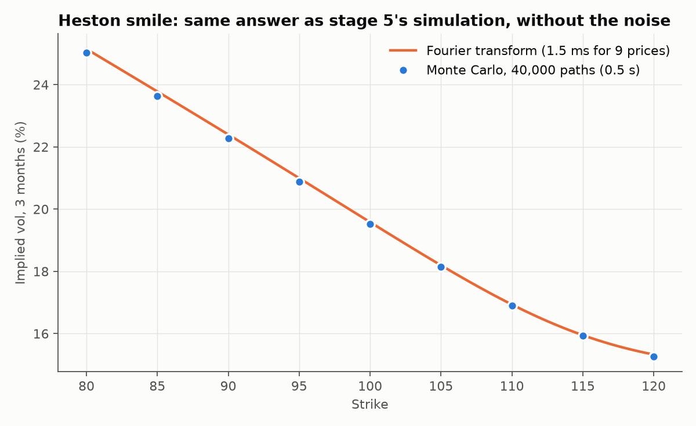

6. **Calibration recovers the smile, and most of the parameters.** Fitting
   36 quotes with 0.2 vol points of noise takes 0.2 s and leaves a fit
   error of 0.16 vol points, the size of the noise. ρ (the slope) and ξ
   (the curvature) come back within about 1%; κ is the least well determined
   (2.56 against a true 2.50), because a faster mean reversion and a
   different long-run level produce almost the same smile.

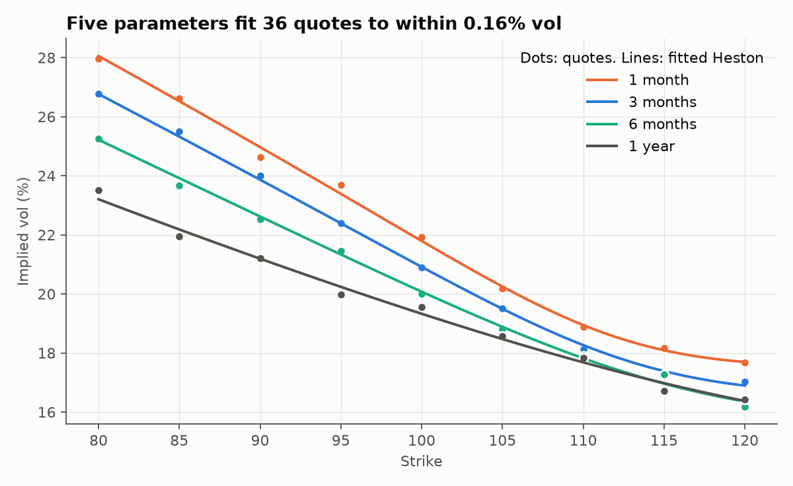

The calibration here uses quotes generated from a known model. Fitting real
SPY quotes is stage 6.

## Roadmap

- [x] **1. Engine:** pricer and Greeks, tested against finite differences and the BS PDE
- [x] **2. Discrete hedging error** vs rebalancing frequency
- [x] **3. Implied ≠ realised vol:** P&L ≈ ½∫Γ S²(σ²_real − σ²_imp)dt; hedging at implied vs realised vol (path-dependent vs locked-in P&L)
- [x] **4. Transaction costs:** time-based vs delta-band hedging, Leland's adjusted vol, the cost/risk frontier
- [x] **5. Wrong model:** generate prices with Heston or jump-diffusion, hedge with BS, look at the tails
- [x] **5b. Pricing toolkit:** American options (tree, Longstaff–Schwartz), PDE solver with barriers, Heston by Fourier transform, calibration
- [x] **5c. The desk:** dashboard and market-data layer, verified in the browser on real Cboe and Yahoo data (the Alpaca source is untested live)
- [ ] **6. Real data:** back out implied vol from SPY option quotes and backtest a hedge on actual prices
- [ ] **7. Deep hedging:** a neural network trained to hedge under costs (Buehler et al., 2019), compared with BS delta
- [ ] **8. Options market-making layer:** quote around model value with an inventory skew (Avellaneda–Stoikov) and delta-hedge the resulting book

## References

- Derman, E. & Kamal, M. (1999). *When You Cannot Hedge Continuously: The Corrections of Black-Scholes.* Risk.
- Ahmad, R. & Wilmott, P. (2005). *Which Free Lunch Would You Like Today, Sir?* Wilmott Magazine.
- Cox, J., Ross, S. & Rubinstein, M. (1979). *Option Pricing: A Simplified Approach.* Journal of Financial Economics.
- Longstaff, F. & Schwartz, E. (2001). *Valuing American Options by Simulation.* Review of Financial Studies.
- Albrecher, H., Mayer, P., Schoutens, W. & Tistaert, J. (2007). *The Little Heston Trap.* Wilmott Magazine.
- Broadie, M. & Kaya, Ö. (2006). *Exact Simulation of Stochastic Volatility and Other Affine Jump Diffusion Processes.* Operations Research.
- Heston, S. (1993). *A Closed-Form Solution for Options with Stochastic Volatility.* Review of Financial Studies.
- Merton, R. (1976). *Option Pricing When Underlying Stock Returns Are Discontinuous.* Journal of Financial Economics.
- Leland, H. (1985). *Option Pricing and Replication with Transactions Costs.* Journal of Finance.
- Buehler, H., Gonon, L., Teichmann, J. & Wood, B. (2019). *Deep Hedging.* Quantitative Finance.
